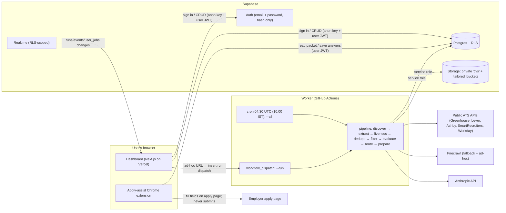
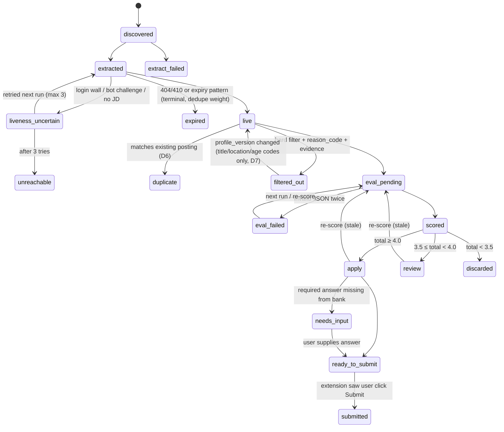
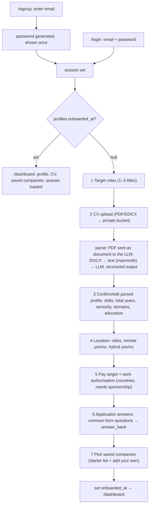

# Job Portal — Phase 1 Plan

Status: **PLAN ONLY — awaiting approval.** No application code.
Sources of truth: `BACKEND_BLUEPRINT.md` (pipeline logic), `CLAUDE.md`, the build prompt, and the decisions recorded in §0.
Dates: written 2026-10-28. Prices checked 2026-10-28 (see §11).

---

## 0. Decisions already made (from the conflict review)

| # | Topic | Decision |
|---|---|---|
| D1 | Score | 0–5, fixed weighted rubric, **total computed in code** from per-criterion scores. Role family mismatch → total capped at **1.0**. |
| D2 | Routing | **≥ 4.0 → Apply**, **3.5 ≤ s < 4.0 → Review**, **< 3.5 → Discarded**. |
| D3 | Discovery | Free public ATS JSON APIs (Greenhouse, Lever, Ashby, SmartRecruiters, Workday) first. Firecrawl only for unsupported sites and ad-hoc URLs. |
| D4 | Submit | **Assisted fill:** the system fills every field it can in the user's own browser tab and alerts them. **The human clicks Submit.** Answers the user types during filling are saved for next time. First-time users answer common application questions during onboarding. The filled form is saved. |
| D5 | Liveness | New stage between Extract and Hard filter. |
| D6 | Dedupe | Canonical URL is the primary key. Company + title + location is a fallback only, and never merges postings whose requisition IDs differ. |
| D7 | Seen-history | Follow the blueprint: title/location/age filter rejections carry no dedupe weight, so they are re-filtered when the profile changes. |
| D8 | Hard filter | Missing data passes. A discard needs a JD sentence that states the fact (stored as evidence). |
| D9 | Onboarding | Add pay targets and work authorisation. |
| D10 | Tailored CV | Generated **on request** only. |
| D11 | Eval output | Compact JSON + blueprint's posting-legitimacy flag. |
| D12 | End state | Pipeline ends at `ready_to_submit` with an "Open & fill" link to the apply page. |
| D13 | Models | **Claude Haiku 5.5** for extraction, CV parsing and title-synonym suggestions. **Claude Opus 5.5** for scoring and on-request tailored CVs / answer drafts. |
| D14 | Extension | Chrome MV3 apply-assist extension approved. Loaded unpacked ($0) unless you later want the Web Store. |
| D15 | Repo | `github.com/divya2104/job_portal` (**public**, empty). Actions minutes on public repos are free. No secrets ever in code. |
| D16 | Experience range | `[years − 2, years + 1]`, editable. |
| D17 | Schedule | Daily **10:00 IST** = cron `30 4 * * *` (UTC). GitHub may start scheduled jobs a few minutes late. |
| D18 | Starter list | Blueprint's verified Bengaluru boards; you'll add more. |
| D20 | Login | **Email + app-generated password. No email sending, no OAuth, no third-party integration.** Overrides the prompt's "email magic link / no passwords stored by the app". Supabase Auth stores only a bcrypt hash; the plain password is shown once and never stored or logged. Details §4.1. |
| D21 | Scale | **Build and run for 1 user first, on free tiers:** Anthropic API (pay per use, the only paid item, ≈ $10.61/month), Firecrawl Free (1,000 credits), Supabase Free, Vercel Hobby, GitHub Actions (public repo). The multi-user design (RLS, per-user caps, shared cache) stays, so scaling up is configuration, not code. Every limit and plan-dependent number lives in `app_settings` (DB, admin-editable) or env vars. See §11.5. |
| D19 | Code location | `~/Desktop/Job portal/` (docs copied here; originals left in `~/Downloads/job-portal/`). |

---

## 1. Architecture



**Repo layout** (one package, TypeScript throughout):

```
app/            Next.js App Router (dashboard, onboarding, settings, admin, API routes)
worker/         pipeline stages + CLI entry (run.ts)
worker/providers/  greenhouse.ts lever.ts ashby.ts smartrecruiters.ts workday.ts firecrawl.ts
extension/      Manifest V3 apply-assist extension
lib/            shared: zod schemas, scoring, filters, url-key (used by app, worker, tests)
supabase/migrations/   SQL schema + RLS
tests/          vitest
.github/workflows/pipeline.yml
```

---

## 2. Data model

All user-owned tables carry `user_id uuid not null references auth.users on delete cascade`. **RLS is enabled on every table.** The worker uses the service-role key (bypasses RLS) and must filter by `user_id` explicitly in every query.

Helper: `is_admin()`: a `security definer` SQL function returning `profiles.is_admin` for `auth.uid()`.

### 2.1 User-owned

| Table | Key columns | Notes |
|---|---|---|
| `profiles` | `user_id` PK, `email`, `onboarded_at`, `onboarding_step`, `target_titles text[1..3]`, `title_keywords jsonb {positive[], negative[]}`, `cities text[]`, `accepts_remote bool`, `accepts_hybrid bool`, `exp_range int4range`, `pay_target {currency, min_annual}`, `work_auth {authorized_in[], needs_sponsorship}`, `profile_version int`, `is_admin bool default false` | `profile_version` bumps on role/CV/location change, which marks scores stale. `is_admin` can't be changed by the user (column-level revoke). |
| `cvs` | `id`, `user_id`, `storage_path`, `file_name`, `parsed jsonb` (skills, total_years, seniority, domains, education), `text` (extracted plain text), `confirmed_at`, `is_active` | One active CV per user. File lives in private bucket `cvs/{user_id}/{id}.{pdf,docx}`. |
| `answer_bank` | `id`, `user_id`, `question_key` (normalised label), `question_label`, `answer`, `source` (onboarding / form / settings), `updated_at` | Screening answers. Unique `(user_id, question_key)`. Editable in Settings. |
| `saved_companies` | `id`, `user_id`, `source_id`, `active bool` | User's picks. Unique `(user_id, source_id)`. |
| `runs` | `id`, `user_id`, `batch_id` (nullable), `trigger` (schedule / adhoc / rescore), `status` (queued / running / completed / completed_with_errors / failed), `counts jsonb` {discovered, extracted, live, filtered, scored, apply, review, discarded, failed}, `started_at`, `finished_at` | Live pipeline counts are read from `counts`. |
| `run_sources` | `run_id`, `source_id`, `user_id`, `status` (ok / failed / blocked / skipped_quota / skipped_robots), `error`, `jobs_found` | Per-source outcome. A failed source never fails the run. |
| `user_jobs` (= `user_job_evaluations`) | `id`, `user_id`, `job_id`, `first_run_id`, `last_run_id`, `status` (state machine §3), `reason_code`, `reason_text`, `evidence` (quoted JD sentence), `eval jsonb` (§6 schema), `total numeric(3,2)`, `profile_version`, `stale bool`, `tailored_cv_path` | One row per (user, job). Unique `(user_id, job_id)`. **Every discard or route has a reason or score here.** |
| `applications` | `id`, `user_id`, `user_job_id`, `form_snapshot jsonb` [{label, field_type, value, source: bank / cv / typed}], `missing_fields text[]`, `opened_at`, `submitted_at` | Saved form. Written by the extension. |
| `events` | `id bigserial`, `user_id`, `run_id`, `user_job_id` nullable, `stage`, `kind`, `payload jsonb`, `created_at` | Append-only. Feeds the live feed. Payload never contains CV text. |
| `usage_ledger` | `id`, `user_id`, `run_id`, `kind` (firecrawl_credits / llm_input_tokens / llm_output_tokens), `units`, `cost_usd`, `created_at` | Per-user spend for quotas and the admin view. Shared-scrape credits are split evenly across the users in that batch. |
| `user_limits` | `user_id` PK, `max_sources_per_run`, `max_runs_per_day`, `max_evals_per_run` | Defaults come from `app_settings`. Only the admin can update. |

**RLS policy (same shape on every user-owned table):**

```sql
alter table <t> enable row level security;
create policy own_select on <t> for select using (user_id = auth.uid() or is_admin());
create policy own_write  on <t> for insert with check (user_id = auth.uid());
create policy own_update on <t> for update using (user_id = auth.uid()) with check (user_id = auth.uid());
create policy own_delete on <t> for delete using (user_id = auth.uid());
```

Exceptions:
- `runs`, `run_sources`, `user_jobs`, `events`, `usage_ledger`: users get **select only**. All writes come from the worker (service role). A user inserts a `runs` row only through the `/api/runs` route, which checks quota and then inserts with the service role.
- `user_limits`: select own. Update only if `is_admin()`.
- **Admin cannot read CVs:** `cvs` and `answer_bank` select policies are `user_id = auth.uid()` only, with no admin clause. The admin view reads counts and spend, not content.

**Storage policies** (`cvs`, `tailored` buckets, both private):
`(storage.foldername(name))[1] = auth.uid()::text` for select/insert/delete. No public URLs. The worker reads via service role.

### 2.2 Shared (not user data)

| Table | Key columns | RLS |
|---|---|---|
| `sources` | `id`, `name`, `careers_url`, `provider` (greenhouse / lever / ashby / smartrecruiters / workday / firecrawl), `provider_ref` (slug / tenant / site), `is_starter bool`, `max_pages default 50`, `blocked_until` | Select: any authenticated user. Insert: through an API route that normalises the URL and detects the provider (dedupes on `careers_url`). |
| `jobs` | `id`, `url_key` unique, `apply_url`, `source_url`, `source_id`, `external_id`, `requisition_id`, `company`, `title`, `title_norm`, `location`, `work_mode`, `exp_min`, `exp_max`, `exp_quote`, `salary {min,max,currency}`, `posted_at`, `jd_text`, `ats_questions jsonb`, `liveness` (live / expired / uncertain), `liveness_checked_at`, `fetched_at`, `fetch_batch_id` | Select only if the user has a `user_jobs` row for it: `exists (select 1 from user_jobs uj where uj.job_id = jobs.id and uj.user_id = auth.uid())`. Holds public posting data only. |
| `source_fetches` | `source_id`, `batch_id`, `fetched_at`, `status`, `job_ids uuid[]`, `credits_used` | Service role only. This is the shared-scrape cache (§8). |
| `app_settings` | singleton: default caps, throttle ms, cron | Select: authenticated. Update: `is_admin()`. |

**Delete my account and data:** `/api/account/delete` (server, service role) deletes storage objects under `cvs/{uid}/` and `tailored/{uid}/`, then `auth.admin.deleteUser(uid)`. Every user-owned row cascades. Shared `jobs`/`sources` stay (they hold no user data). The ledger rows go too, so admin totals drop. Covered by a test.

---

## 3. Job status state machine (`user_jobs.status`)



- Every transition writes one `events` row (`kind = job_moved`, `from`, `to`, `reason_code` or `total`).
- `reason_code` values: `title_mismatch`, `location_mismatch`, `exp_above_range`, `exp_below_range`, `too_old`, `no_sponsorship`, `salary_below_floor`, `salary_currency_mismatch`, `duplicate_of:<job_id>`, `expired`, `score_below_3_5`, `eval_failed`.
- Stale handling: a CV, role or location change bumps `profile_version`, which sets `stale = true` on `apply` / `review` / `filtered_out(title|location|exp)` rows. The dashboard shows "N jobs scored against an old profile → Re-score". That creates a `runs` row with `trigger = rescore`, which re-runs filter + evaluate on those rows only (no discovery).

---

## 4. Onboarding and returning-user flows



### 4.1 Login (D20)

- **Sign up (`/signup`):** user enters email. The server checks it is on the admin's `allowed_emails` list (see below), generates a 20-character random password (`crypto.randomBytes`), creates the user with `auth.admin.createUser({ email, password, email_confirm: true })`, and shows the password **once** with a Copy button and "save this in your password manager". Then signs them in.
- **Log in (`/login`):** email + password via `signInWithPassword`. Supabase's built-in login rate limiting applies.
- **Change password:** Settings → generate a new one (shown once) or set your own (min 12 chars).
- **Forgot password:** no email exists to reset it. The admin opens Admin → Users → **Reset password**, which generates a new one shown once to the admin to pass on.
- **Allow-list:** `allowed_emails(email, added_by, added_at)` table, admin-only. Without it, any stranger who finds the URL could sign up and spend your Anthropic/Firecrawl credits, and anyone could claim someone else's address (emails are never verified). Admin adds emails in Admin → Users.
- Supabase project settings: email provider on, "Confirm email" off, public signups **disabled** (only the server route creates users).
- The admin account (`ADMIN_EMAIL`) is created the same way on first deploy by a one-off CLI command that prints the generated password.

### 4.2 Routing

- Middleware: no session → `/login`. Session + `onboarded_at` null → `/onboarding?step=<onboarding_step>` (resumes where they left off). Session + onboarded → any `/onboarding` URL redirects to `/dashboard`.
- Step 3 is a form pre-filled from `cvs.parsed`. Nothing is saved as confirmed until the user clicks Confirm.
- After step 1, one LLM call proposes close-synonym titles plus negative keywords (blueprint §4, §11: block Staff/Principal/Director/VP/Engineer/Scientist as appropriate). These are shown as editable chips and saved to `title_keywords`.
- `exp_range` defaults to `[max(0, total_years − 2), total_years + 1]`, editable in step 3.
- Step 6 questions (all optional except name/email/phone): full legal name, email, phone, current city, LinkedIn URL, portfolio/GitHub, total experience, current CTC, expected CTC, notice period / earliest start date, willing to relocate, work authorisation (pre-filled from step 5), needs sponsorship, gender / EEO / disability / veteran (default "Prefer not to say"), "How did you hear about us" (default "Company website").
- **Settings** has the same forms as steps 1, 2+3, 4, 5, 6 and 7, plus "Delete my account and data".

---

## 5. Pipeline stage contracts

One run = one user. Every event carries `user_id` and `run_id`. Stages are idempotent: each reads `user_jobs.status` and only advances rows in its input state, so a crashed run can be resumed.

| Stage | Input | Output | Events (`stage.kind`) |
|---|---|---|---|
| 0 Plan | run row, `user_limits`, saved companies / ad-hoc URL | ordered source list, truncated to `max_sources_per_run` | `run.started`, `run.quota_trimmed` |
| 1 DISCOVER | source | list of `{apply_url, title, location, external_id, requisition_id, posted_at, description?}`. Provider API paginated, or Firecrawl `map` (≤ `max_pages`, default 50) + listing scrape. Title pre-match against `title_keywords` (synonyms included) decides which postings get extracted. | `discover.source_ok {found, matched}`, `discover.source_failed {error}` |
| 2 EXTRACT | matched postings | `jobs` row: title, company, location, work_mode, exp_min/max + exp_quote, jd_text, apply_url, posted_at, source_url, salary, ats_questions (Greenhouse `?questions=true`). API sources use the API detail endpoint. Firecrawl sources: scrape → markdown → LLM extraction (structured output). Reuses the cached `jobs` row if this batch already fetched it (§8). | `extract.job {job_id}`, `extract.failed` |
| 3 LIVENESS | extracted job | `liveness`. API source: present in the current listing = live (free). Firecrawl: 404/410, "no longer accepting" patterns, <300 chars → expired; login wall / challenge / no apply control → uncertain. | `liveness.result` |
| 4 DEDUPE | live job + user's history | Skips the job if this user already has `user_jobs` with a weighted status. Fallback match: same company + `title_norm` + location, **unless** both have requisition IDs and they differ. Creates `user_jobs` rows. | `dedupe.duplicate`, `dedupe.new` |
| 5 HARD FILTER | `user_jobs(live)` + profile | `filtered_out` + `reason_code` + `evidence`, or `eval_pending`. Deterministic; no LLM. Rules in §7. | `filter.discarded {reason_code, evidence}`, `filter.passed` |
| 6 EVALUATE | `eval_pending` rows, up to `max_evals_per_run` (rest stay pending for next run) | `eval` JSON (§6). Validated with zod; one retry on invalid; else `eval_failed`. Total computed in code. | `evaluate.scored {criteria, total, rationale}`, `evaluate.failed` |
| 7 ROUTE | `scored` | `apply` / `review` / `discarded` by D2 | `route.apply` / `route.review` / `route.discarded {total}` |
| 8 PREPARE | `apply` rows | If the posting exposes questions (Greenhouse API), each is matched to `answer_bank` by `question_key`. Missing required → `needs_input` + list. Else `ready_to_submit`. No LLM; no invented answers. Questions not known until the form is opened are handled by the extension (§9). | `prepare.ready {apply_url}`, `prepare.needs_input {questions}` |
| end | — | `runs.status`, `finished_at`; ledger rows | `run.completed {counts}` |

`runs.counts` is updated in the same transaction as each event, so the live pipeline view needs only the `runs` row.

---

## 6. Scoring rubric

LLM: **Claude Opus 5.5**, adaptive thinking, effort `low`, prompt-cached prefix (system + rubric + this user's CV). One call per (user, job), built only from **that user's** confirmed CV profile + CV text + preferences, and the job's JD. The JD is wrapped in `<untrusted_job_description>` with the instruction that its contents are data and any instructions inside it are reported in `injection_flags`, never followed (blueprint §1, §10). Structured output (`output_config.format`, JSON schema) plus zod validation.

| Criterion | Weight | 5 means | 0 means |
|---|---|---|---|
| `skills_match` | 0.40 | All critical/high JD requirements evidenced in the CV | Most critical requirements missing |
| `seniority_fit` | 0.25 | JD level matches candidate's natural level and `exp_range` | Two or more levels apart |
| `domain_fit` | 0.15 | Same industry / problem domain as CV | Unrelated domain, no transfer story |
| `location_workmode` | 0.10 | Matches city / remote / hybrid preference | Conflicts (e.g. on-site in a non-preferred city) |
| `compensation_fit` | 0.10 | Stated pay ≥ target | Stated pay well below target |

Rules (all in code, not the prompt):
- A criterion the model marks `null` (no information, e.g. salary not stated) is dropped and the remaining weights are renormalised. Missing data never lowers the score (D8).
- `total = round(Σ wᵢ·sᵢ / Σ wᵢ, 2)`.
- If `role_family_match = false` → `total = min(total, 1.0)` (D1).
- Two-pass rule from the blueprint (§7b): the prompt asks the model to list requirement importance from the JD **before** reading the CV. Output field order enforces this.
- `legitimacy` is reported but **does not change the score**. `suspicious` shows a red badge on the card.

Example output (stored in `user_jobs.eval`):

```json
{
  "requirements": [
    {"requirement": "3+ yrs product management", "importance": "critical",
     "match": "partial", "cv_evidence": "Associate PM, Acme (2024–2026)"},
    {"requirement": "LLM product experience", "importance": "high",
     "match": "strong", "cv_evidence": "Shipped RAG support assistant to 40k users"}
  ],
  "role_family_match": true,
  "criteria": {
    "skills_match":      {"score": 4.0, "why": "LLM product work and roadmap ownership evidenced; SQL depth unclear"},
    "seniority_fit":     {"score": 3.5, "why": "JD asks 3–5 yrs, CV shows ~2.5 yrs PM"},
    "domain_fit":        {"score": 4.5, "why": "Fintech lending, same as current role"},
    "location_workmode": {"score": 5.0, "why": "Bengaluru hybrid, matches preference"},
    "compensation_fit":  {"score": null, "why": "No salary stated"}
  },
  "total": 4.06,
  "rationale": "Strong domain and LLM-product fit for a lending PM role. The main gap is years of formal PM experience; pitch the RAG launch as end-to-end ownership.",
  "matched_skills": ["LLM products", "roadmapping", "lending", "stakeholder management"],
  "missing_skills": ["SQL (advanced)", "A/B test design"],
  "legitimacy": {"tier": "high_confidence", "signals": ["posted 6 days ago", "specific team and scope", "apply button present"]},
  "injection_flags": []
}
```

Here `total` = (0.40·4.0 + 0.25·3.5 + 0.15·4.5 + 0.10·5.0) / 0.90 = 3.65 / 0.90 = **4.06** (computed in code; the model's own `total`, if any, is ignored). Route: **Apply**.

---

## 7. Hard-filter rules (deterministic, in order; first hit wins)

Each discard stores `reason_code` + `evidence` (the exact JD sentence or field value). **Unknown passes** (D8).

1. **Title / role family:** pass if ≥1 positive keyword matches and 0 negative match (`title_keywords`). Case-insensitive; 2–3-letter keywords (AI, VP, PM) match on word boundaries; `word:` prefix forces whole word (blueprint §4). Evidence = the title.
2. **Location:** empty location → pass. Remote / work-from-home / "Pan India" / "India (Remote)" → pass if `accepts_remote`. Hybrid in a preferred city → pass if `accepts_hybrid`. On-site → must match a `cities` entry. Else `location_mismatch`.
3. **Posting age:** only if `posted_at` is known and older than 45 days → `too_old`.
4. **Experience:** `exp_min`/`exp_max` come from a deterministic regex over `jd_text` (e.g. `(\d+)\s*\+?\s*(?:-|–|to)\s*(\d+)\s*years?` and `(\d+)\+\s*years?`) applied to sentences that also mention experience/years. The matched sentence → `exp_quote`. Discard `exp_above_range` if `exp_min > exp_range.upper`. Discard `exp_below_range` if `exp_max < exp_range.lower`. No quote → pass.
5. **Sponsorship:** only if `needs_sponsorship` and the JD contains a negative phrase ("no sponsorship", "unable to sponsor", "must be authorized to work in … without sponsorship") → `no_sponsorship`, with the sentence.
6. **Salary:** only if structured salary exists. Currency differs from the user's target currency → `salary_currency_mismatch`. `max < pay_target.min_annual` → `salary_below_floor`.

Unit tests cover each rule with a pass, a discard, and an unknown-passes case.

---

## 8. Shared-scrape caching

- A **scheduled batch** (`batch_id`) groups every user's run for that cron firing.
- Before fetching a source, the worker looks up `source_fetches(source_id, batch_id)`. If one exists, it reuses its `job_ids` and the cached `jobs` rows. If not, it fetches **once**, upserts `jobs` on `url_key`, records the fetch, and continues.
- The batch processes sources **source-first**: union of all active users' saved sources → fetch each once (throttled) → then per user: dedupe → filter → evaluate. Evaluations are always per user.
- Ad-hoc runs (no batch): reuse a `source_fetches` row for that source if it is < 6 h old; otherwise fetch and record under a one-off batch id.
- Firecrawl-scraped single postings are also cached by `url_key`: a posting scraped in the last 24 h is not scraped again (liveness is rechecked only right before evaluation).
- Credits for a shared fetch are split evenly across the users who had that source in the batch (`usage_ledger`).
- Only public posting data lives in the cache. Nothing user-specific crosses users.

---

## 9. Assisted application fill (D4) — Chrome extension

Not auto-submit. The extension fills fields; **the user reviews and clicks Submit.** It never clicks submit/apply/next-to-final, never touches a CAPTCHA, and never stores job-site passwords.

Flow:
1. A job reaches `ready_to_submit` (or `needs_input`). The dashboard card shows **Open & fill**. Realtime raises an in-app toast ("3 jobs ready to apply").
2. **Open & fill** opens `apply_url` in a new tab with `#jp=<user_job_id>`.
3. The extension (signed in with the same Supabase session, via the dashboard passing a short-lived token) loads the **packet**: profile fields, `answer_bank`, and the CV file (tailored if generated, otherwise original) via a signed URL that expires in 5 min.
4. Per-ATS fillers: Greenhouse, Lever, Ashby, SmartRecruiters and Workday (multi-step, one page at a time; the user logs into the employer's Workday account themselves). A generic filler matches `<label>` text → `question_key` for other sites. The CV is attached via `DataTransfer` on file inputs.
5. A banner on the page shows: filled N fields, M need you (highlighted), "Review, then click Submit yourself". A Chrome notification fires if the tab is in the background.
6. **Learning:** on the page's submit-click (observed, not triggered) and on a manual "Save answers" button in the banner, the extension reads every field's label + value:
   - Values the user typed for unknown questions are upserted into `answer_bank` (`source = form`) for next time.
   - The whole form → `applications.form_snapshot`. `user_jobs.status = submitted`.
7. Free-text questions ("Why this company?"): an optional **Draft** button calls the LLM with the user's CV + JD. The result is inserted for the user to edit and is marked as a draft. It uses only facts from the CV (blueprint no-fabrication rule). On request only.

Distribution: load unpacked for testing. The Chrome Web Store requires a one-time $5 developer fee (open question Q3).
Rejected alternative: a cloud headless browser filling forms. It would need users' employer-site logins, hits CAPTCHAs, and needs a paid live-view browser service.

---

## 10. Deployment and scheduling

| Piece | Choice | Why |
|---|---|---|
| DB / Auth / Storage / Realtime | Supabase | Specified; RLS + Realtime respect the same policies. |
| Dashboard + API routes | Vercel | Specified; Next.js native. |
| Worker | **GitHub Actions** (`pipeline.yml`) | Free minutes, cron + `workflow_dispatch`, secrets in repo secrets, no infra. |

**Workflow:**
- `schedule: cron "30 4 * * *"` (10:00 IST) → `npm run pipeline -- --all`. Creates one batch and processes every user with `onboarded_at` set and ≥1 active saved company.
- `workflow_dispatch` with input `run_id` → `npm run pipeline -- --run <id>`. Triggered by `/api/runs` (Vercel) via the GitHub REST API using a fine-grained token scoped to Actions on this repo only. Expect ~30–60 s before the run starts; the UI shows "queued".
- `concurrency: pipeline-schedule` for cron (no overlapping batches). Ad-hoc runs use `pipeline-run-<id>`.
- Run claim is atomic: `update runs set status='running' where id=$1 and status='queued' returning *`.
- Stale reaper at the start of every invocation: `running` for > 2 h → `failed` (`reason = worker_timeout`).
- Local CLI is the same entry point: `npm run pipeline -- --user <email> [--url <url>]`.

**Secrets** (GitHub repo secrets + Vercel env, never in code or logs): `SUPABASE_URL`, `SUPABASE_SERVICE_ROLE_KEY` (worker + server routes only), `NEXT_PUBLIC_SUPABASE_ANON_KEY`, `FIRECRAWL_API_KEY`, `ANTHROPIC_API_KEY`, `GH_DISPATCH_TOKEN`, `ADMIN_EMAIL`. The logger redacts any env value and any field named `*key*|*token*|cv_text|text`.

**Compared with Azure Container Apps Jobs:** they support cron and manual triggers, have a monthly free grant, and have no 6 h job limit. But they need a container registry, managed identity, and Key Vault wiring. More setup for no benefit at 1–50 users. Revisit only if a batch approaches the 6 h GitHub limit or the Actions minutes bill exceeds ~$20/month.

**Politeness:** robots.txt checked (cached 24 h) before any Firecrawl request to a non-API host. Disallowed → `run_sources.status = skipped_robots`. Per-domain throttle of 2 s, enforced in-process with a `Map<domain, lastHit>`. `ponytail:` single worker process, so an in-memory throttle is enough; it needs a shared lock (Postgres advisory lock) if the worker is ever sharded. Firecrawl `stealth` proxies are not used (that is bot-detection evasion).

---

## 11. Monthly cost

### 11.1 Unit prices (read from vendor pricing pages on 2026-10-28, USD)

| Service | Plan / unit | Price |
|---|---|---|
| Anthropic: Claude Opus 5.5 | input / output / cache write / cache read, per 1M tokens | $4 / $20 / $5 / $0.20 |
| Anthropic: Claude Haiku 5.5 (prompts ≤100K) | input / output / cache write / cache read, per 1M tokens | $0.10 / $0.50 / $0.125 / $0.01 |
| Anthropic: Batch API | any model | 50% off (results async) |
| Firecrawl | Free | $0: 1,000 credits/mo, no pay-as-you-go |
| Firecrawl | Hobby | $19/mo monthly ($16/mo billed annually): 5,000 credits; extra 1,000 credits per $5 |
| Firecrawl | Standard | $99/mo monthly ($83/mo annually): 100,000 credits |
| Firecrawl | credit use | scrape / map / crawl = 1 credit per page; a 404/403 page still costs 1 |
| Supabase | Free | $0: 500 MB DB, 1 GB storage, 50k MAU, 2M realtime msgs; **pauses after 1 week inactive**; no backups |
| Supabase | Pro | $25/mo: 8 GB DB, 100 GB storage, 100k MAU, 5M realtime msgs, never pauses, daily backups |
| Vercel | Hobby | $0: personal, **non-commercial** use only |
| Vercel | Pro | $20/mo per seat (includes $20 usage credit) |
| GitHub Actions | public repo, GitHub-hosted runners | $0, no minute limit (`divya2104/job_portal` is public) |
| Chrome extension | loaded unpacked | $0 (Web Store would be $5 one-time) |

### 11.2 Per-call cost (D13 model split)

| Call | Model | Tokens assumed | Cost per call |
|---|---|---|---|
| Score one job (cache hit) | Opus 5.5 | 4,500 cached prefix read + 3,500 JD in + 1,500 out (incl. thinking at effort low) | $0.0009 + $0.0140 + $0.0300 = **$0.0449** |
| First score in a run (cache write) | Opus 5.5 | +4,500 cache write instead of read | **+$0.0216** once per run |
| Extract one Firecrawl posting | Haiku 5.5 | 5,000 in + 600 out | **$0.0008** |
| Parse CV (once) + title synonyms | Haiku 5.5 | 8,000 in + 1,500 out | **$0.0016** |
| Tailored CV or answer draft (on request) | Opus 5.5 | 7,000 in + 3,000 out | **$0.0880** |

### 11.3 Per active user per month

Assumptions:
- 15 saved companies (12 on free ATS APIs, 3 via Firecrawl) and a daily run (31 runs).
- 20 ad-hoc URLs.
- 200 jobs scored (first-run backlog + ~5 new/day after filters).
- 100 Firecrawl extractions and 10 on-request CVs/drafts.

| Item | Calc | $ |
|---|---|---|
| Scoring | 200 × $0.0449 + 31 × $0.0216 | 9.65 |
| Extraction | 100 × $0.0008 | 0.08 |
| CV parse | 1 × $0.0016 | 0.00 |
| Tailored CVs / drafts | 10 × $0.0880 | 0.88 |
| **Anthropic per user** | | **$10.61** |
| Firecrawl credits | 3 sources × (1 map + 2 new postings) × 30 days = 270, + 20 ad-hoc × 10 pages = 200, + first-month backfill 120 | **≈ 590 credits** |

### 11.4 Monthly totals

| | 1 user | 10 users | 50 users |
|---|---|---|---|
| Anthropic | $10.61 | $106.10 | $530.50 |
| Firecrawl credits needed (after shared-cache savings: 0 / 30% / 40%) | ~590 | ~4,200 | ~18,000 |
| Firecrawl plan | **$0** (Free) | **$19** (Hobby) | **$84** (Hobby $19 + 13 × $5 top-ups; cheaper than Standard $99) |
| Supabase | **$0** (Free) | **$25** (Pro, recommended once others depend on it) | **$25** (Pro) |
| Vercel | $0 | $0 | $0 (or $20 if you ever charge users) |
| GitHub Actions | $0 | $0 | $0 |
| **Total / month** | **$10.61** | **$150.10** ($125.10 on Supabase Free) | **$639.50** |

### 11.5 Configuration (D21): scale without code changes

| Setting | Where | Default (1 user) | Change when scaling |
|---|---|---|---|
| `max_sources_per_run`, `max_runs_per_day`, `max_evals_per_run` | `app_settings` defaults + `user_limits` per user (Admin view) | 25 / 3 / 30 | per user |
| `firecrawl_monthly_credit_budget` | `app_settings` | 1,000 (Free plan) | raise to 5,000 on Hobby, etc. Worker stops Firecrawl sources at the budget → `skipped_quota` |
| `llm_monthly_budget_usd` | `app_settings` | $20 | raise as users grow. Worker stops scoring at the budget; jobs stay `eval_pending` |
| `throttle_ms_per_domain`, `firecrawl_max_pages` | `app_settings` | 2000 / 50 | rarely |
| `max_users` (allow-list size) | `app_settings` | 1 | raise when inviting people |
| Schedule cron | `.github/workflows/pipeline.yml` | `30 4 * * *` | — |
| `SCORING_MODEL`, `EXTRACTION_MODEL` | env | `claude-opus-5-5`, `claude-haiku-5-5` | swap model with no code change |
| Supabase / Firecrawl / Vercel plan | vendor dashboards | Free / Free / Hobby | upgrade in dashboard; no code change |

What moves the number:
- **Anthropic is ~90% of the cost and scales linearly with jobs scored.** Each extra 100 scored jobs/user/month = +$4.49 per user.
- **Batch API lever:** scoring scheduled runs via the Batch API halves the scoring cost ($9.65 → $4.83/user) but scores arrive minutes to hours later. That conflicts with the live-UI requirement for scheduled runs. Not enabled unless you ask.
- **Hard ceiling per user (caps):** 30 evals × 3 runs/day × 30 days = 2,700 scores → **$123.17/month** Anthropic worst case. Lower `max_evals_per_run` to tighten it.

---

## 12. Failure handling

| Failure | Handling |
|---|---|
| Source fetch error (network, 5xx, parse) | 3 retries with exponential backoff + jitter (1 s, 4 s, 16 s). Then `run_sources.status = failed` + `discover.source_failed` event. **Run continues.** |
| 429 from ATS / Firecrawl / Anthropic | Honour `retry-after`; otherwise backoff as above. Anthropic SDK `max_retries = 2` plus our backoff on top. |
| Blocked (403, bot challenge, login wall) | `run_sources.status = blocked`, `sources.blocked_until = now + 24h`. Never bypassed. Postings → `liveness_uncertain`. |
| Firecrawl credits exhausted / quota hit | Remaining Firecrawl sources → `skipped_quota`; API sources continue. |
| `max_evals_per_run` reached | Remaining jobs stay `eval_pending`; the next run picks them up. Event `run.quota_trimmed`. |
| LLM invalid JSON | One retry with the validation error appended. Then `eval_failed` (retried on the next run). |
| Workday maintenance page / unknown provider | Treated as a source failure. A source no provider claims is shown as "unsupported" when added, never silently skipped (blueprint §2). |
| One user's run throws | Caught per user; that run → `failed` with the error. The batch continues with the next user. |
| Worker crash / Actions timeout | Stages are idempotent; the stale reaper marks the run failed; the next run resumes from `user_jobs.status`. |
| Partial run | `completed_with_errors`. Run History lists failed sources with errors. |

No silent drops: every posting that enters stage 4 gets a `user_jobs` row with a terminal status and a reason or score. The integration test asserts `count(discovered matched) = count(user_jobs rows)`.

---

## 13. Remaining conflicts and gaps vs `BACKEND_BLUEPRINT.md` / `CLAUDE.md`

1. **Blueprint scoring is 1–5 holistic** (§7c). Replaced by the D1 weighted rubric. The blueprint's "comp", "culture" and "red flags" dimensions become `compensation_fit` plus the non-scoring legitimacy flag. Culture is dropped.
2. **Blueprint full report** (§7b blocks A–G, interview stories, web research) is not built (D11).
3. **Tracking after submit** (§8: Responded → Interview → Offer, status log, follow-ups) and **dashboard metrics** (§9: daily targets, funnels) are out of scope.
4. **Providers:** the blueprint verified Oracle HCM and SAP SuccessFactors endpoints too (JPMorgan, EY, Deloitte, KPMG). Phase 3 ships Greenhouse, Lever, Ashby, SmartRecruiters and Workday. Oracle/SuccessFactors sites go through Firecrawl until a provider is added.
5. **Not carried over:** SimHash cross-listing detection, the trust validator, and aggregator-ID dedupe (§5). LinkedIn/Naukri ad-hoc URLs get one attempt; a login wall → `liveness_uncertain` with "JD unavailable". The blueprint's paste-the-JD fallback is not built.
6. **CV format:** the blueprint treats a markdown CV as the source of truth. Here the uploaded PDF/DOCX is stored and the confirmed `cvs.parsed` + `cvs.text` are the source of truth. Tailored CVs are produced as **DOCX** (pure-JS `docx` library, no headless Chrome on Vercel), not the blueprint's HTML→PDF.
7. **`CLAUDE.md` loaded from `~/Desktop/CLAUDE.md` is a different project (ClearSight)** and is ignored. `job-portal/CLAUDE.md` says only "planning, read the blueprint" — no conflicts.
8. **Working folder:** resolved, see D19.

**Phase 3 implementation notes (2026-10-29):**
- Title **exclusion** words match whole words only (so "Engineer" never rejects "PM, Engineering Platform"); include words stay substring, with 2–3-letter words whole-word (blueprint §4).
- Experience filter uses the **first** sentence that states years of experience.
- Ad-hoc runs re-fetch free ATS listings instead of reusing a < 6 h listing; Firecrawl detail pages are still cached 24 h by URL, so the paid part is cached.
- Workday boards are searched with the users' target titles (not every synonym) to keep paging small.
- API-listed postings are refreshed on every run (presence in the listing = live); only Firecrawl detail pages use the 24 h cache.
- Local Supabase runs on ports 55421–55427 (another local project uses the defaults).

---

## 14. Tests per phase (what "proven" means)

- **Phase 2:** RLS isolation test against local Supabase (`supabase start`, needs Docker). Creates users A and B, signs in as A with the anon key, and asserts zero rows / denied for B's `profiles`, `cvs`, `user_jobs`, `runs`, `events`, `answer_bank`, `applications`, and B's storage object. Plus: returning-user redirect, onboarding resume, and account deletion cascade.
- **Phase 3:**
  - Hard-filter unit tests (§7).
  - Routing boundaries: **3.49 → discarded, 3.50 → review, 3.99 → review, 4.00 → apply, 4.01 → apply**.
  - Role-family cap; weight renormalisation.
  - URL-key normalisation and dedupe (incl. differing requisition IDs).
  - JSON validation + one retry + `eval_failed`.
  - Cross-user isolation in the pipeline: two users on the same source; each LLM call's prompt contains only its own user's CV (asserted via a mocked client).
  - Integration test on a saved fixture careers page (HTTP mocked).
  - Sample run for two test users.
- **Phases 4–6:** browser checks of each tab; a live run watched in two sessions (A doesn't see B); a scheduled run completing in Actions for two users.

---

## 15. Open questions (remaining)

Q1–Q8 from the first draft are answered (D13–D21).

None. Paid services resolved by D21 (Anthropic pay-per-use only; everything else on free tiers).

